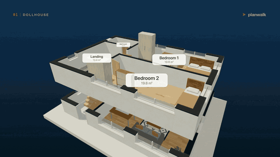
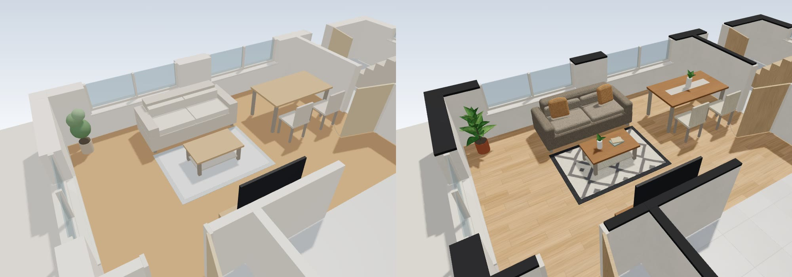

<h1 align="center">planwalk</h1>
<p align="center"><b>Turn a floor plan into a 3D flat you can walk through.</b></p>
<p align="center">Give an AI that can see images a picture of a floor plan, get a small JSON file, open it in one HTML file.<br>Dollhouse view, exploded levels, first-person walk, GLB export.<br>No server. No API keys. planwalk itself uploads nothing.</p>

<p align="center"><a href="https://github.com/MrPawelCz/planwalk/actions/workflows/ci.yml"></a></p>

<p align="center"></p>

<p align="center"><br><sub>The same room of the example house in the clay look (left) and the textured look (right).</sub></p>

<p align="center"><a href="https://mrpawelcz.github.io/planwalk/">Open the viewer</a> · <a href="docs/PROMPT.md">Use it in a chat</a> · <a href="skill/planwalk/SKILL.md">Agent skill</a> · <a href="docs/SPEC.md">Format</a></p>

<p align="center">Po polsku: <a href="https://mrpawelcz.github.io/planwalk/pl/">strona z aplikacją</a> · <a href="README.pl.md">README.pl.md</a></p>

---

## Try it in 60 seconds

**With a chat that can read images (nothing to install)**

1. Open the [live viewer](https://mrpawelcz.github.io/planwalk/), or download `planwalk.html` from the [latest release](https://github.com/MrPawelCz/planwalk/releases/latest) and double click it (it works offline, straight from the file). From a clone, `npm start` serves it at http://127.0.0.1:8080/planwalk.html.
2. Give your floor plan image and the prompt from [`docs/PROMPT.md`](docs/PROMPT.md) ([`docs/PROMPT.pl.md`](docs/PROMPT.pl.md) for Polish drawings) to a chat that can read images. Cover names, addresses and phone numbers on the drawing first. The prompt is designed for chats that can read images. What has been measured is in [`docs/BENCHMARK.md`](docs/BENCHMARK.md): the English prompt on 12 synthetic plans (the current prompt version for Claude Sonnet 5.5 and Claude Haiku 4.5 on all 12, for gpt-6-astra on 7 of 12), and both prompts on 20 real listing plans (10 Polish plans with the Polish prompt, 10 UK plans with the English prompt; Claude Sonnet 5.5 also read the 10 Polish plans with the English prompt) for Claude Sonnet 5.5 and Claude Haiku 4.5 only. Nothing has been measured for gpt-6-astra on real plans, for Gemini or for other chats: they may work, but that is an expectation, not a result (results are welcome).
3. Paste the JSON it returns into the viewer ("Paste JSON"). If the viewer lists problems, press "Copy fix request", paste that back into the same chat, repeat. A plan with a few mistakes still opens: a property the format does not know is ignored, an element that cannot be read (for example an opening of width 0) is skipped and a banner lists what was left out. Only when nothing usable is left is no model built, and the model on screen stays. The exception is a `units` value the viewer does not understand (such as "feet"): that plan is refused and the fix request names it, because a wrong unit would show the model at the wrong scale.

No floor plan at hand? The first-visit card in the viewer links three sample drawings (also in [`docs/samples`](docs/samples)) that you can open or download and run through the same three steps. They are synthetic and were picked because a model read them well, so they show the loop, not how a model reads a typical drawing.

**With an agent that loads skill folders**

Give the agent the folder [`skill/planwalk`](skill/planwalk) (copy it into your agent's skills directory, for Claude Code that is `~/.claude/skills/`, or just point the agent at it) and say: "Turn this floor plan into a 3D walkthrough." The skill reads the plan, validates it, renders it, compares the render with your drawing, and hands you one HTML file. The folder is self-contained: the validator, the screenshot tool and the viewer are inside it, so no clone of this repository is needed. It needs Node 20 or newer; the render check also needs Node 22 and Chrome or Chromium. The skill is a standard `SKILL.md` folder, but this route has not been benchmarked: the benchmark below measures a reading by hand and one call with the plain prompt, not the agent route.

**Just look around**

Pick an example from the menu: a one-bedroom flat and a two-level house with a stair.

**What to expect on real plans**

On 20 real floor plans from public listings (10 Polish, 10 UK) the result was mixed: most readings needed corrections. One call with the prompt gave a model that needed no change in 3 of 30 readings by Claude Sonnet 5.5 (it read the 10 Polish plans twice, with the Polish and with the English prompt, so these are 30 readings of 20 plans) and at most three small corrections in 12 more, while the other 15 were wrong or did not load; none of the 20 readings by Claude Haiku 4.5 was usable even after small corrections (11 did not load). The Polish plans, mostly developer unit cards, did better than the UK agent drawings (for Claude Sonnet 5.5, usable or fixable with small corrections in 13 of 20 readings of Polish plans (10 plans, each read twice) against 2 of 10 of UK plans), and the usual mistakes are missing or misplaced stairs, hallways drawn as empty areas and main rooms that are off in size, so compare the result with your drawing. This is a first look at a small, hand-picked set, scored against the numbers printed on the drawings and judged by an AI that compares the original with a top-down picture of each reading; the method and the limits are in [Real listing plans](docs/BENCHMARK.md#real-listing-plans). When a reading goes wrong, the viewer's "Report a bad reading" button opens a prefilled issue on GitHub; it is a public issue, so cover names and addresses before you paste the plan.

## What you get

- **Dollhouse** with cutaway walls and room names with areas (the area your drawing declares, otherwise an estimate net of the walls, marked with ~), **exploded levels**, top view, free orbit
- **First-person walk** with collisions, doors you can pass through, stairs between levels, a minimap
- **Two looks**: procedural textures (wood boards, tile, carpet, stone, plaster, fabric, linen, knit, rugs, leaves; generated in code, no image files, in real-world scale, details in [`docs/TEXTURES.md`](docs/TEXTURES.md)) on furniture with soft, rounded shapes, or plain clay colours, one click or `?materials=clay`
- **GLB export** (named nodes for walls, rooms, openings, with the textures embedded), PNG snapshot, a **link that holds the plan** (Copy link: the plan is stored inside the link, so whoever gets the link, and the app you send it through, can read it; it opens in a phone browser, and a link copied from a downloaded file points to the live page, so opening it needs a connection; the short link needs Safari 16.4, Chrome 103 or Firefox 113, older browsers use Copy long link), Share image for a picture of the current view, and a **standalone HTML file** with your plan embedded, to open on a computer
- A **validator** that explains each structural mistake it finds in words an AI can act on (the repair loop; it cannot tell whether the plan matches your drawing)

## How it works

```text
floor plan image / PDF / sketch
          |   an AI that reads images (chat or agent), with the prompt or the skill
          v
      plan.json   <-- validator: geometry checks, scale cross-check, readable fixes
          v
planwalk viewer (one HTML file): dollhouse, explode, walk, GLB
```

The JSON is the product. An AI can write it, you can read and fix it, and any tool can consume it. The format is in [`docs/SPEC.md`](docs/SPEC.md) and [`schema/plan.v1.schema.json`](schema/plan.v1.schema.json).

## The format at a glance

```json
{
  "version": 1, "units": "m",
  "levels": [{
    "id": "L0",
    "walls":    [{ "id": "w1", "from": [0, 0], "to": [6, 0], "kind": "exterior" }],
    "openings": [{ "id": "d1", "wall": "w1", "type": "door", "offset": 1.0, "width": 0.9 }],
    "rooms":    [{ "id": "r1", "name": "Studio", "polygon": [[0, 0], [6, 0], [6, 4], [0, 4]], "area": 24 }]
  }]
}
```

Walls are centerlines with a thickness, openings sit on walls, rooms are polygons, levels stack. Optional: stairs, furniture, units (`m`, `cm`, `mm`, `ft`, `in`). Full reference: [`docs/SPEC.md`](docs/SPEC.md).

## Command line

```bash
node tools/validate.mjs plan.json                 # check a plan, readable errors, exit code for CI
node tools/capture.mjs plan.json --out shots/     # headless Chrome (Node 22+): screenshots, console check, --gif (--gif-width, --gif-fps), --glb, --materials clay|textured, --no-panel
node tools/serve.mjs dist 8080                    # serve the viewer locally
node eval/score.mjs truth.plan.json reading.plan.json   # score an AI reading against the known truth (composite 0 to 100)
node eval/make-benchmark.mjs --seed 401 --count 8 --out eval/out/bench   # synthetic plans, 4 drawing styles, truth under opaque codes
node eval/report.mjs eval/out/bench readings/            # score a folder of readings
npm run build                                     # rebuild dist/planwalk.html
npm run build:skill                               # build, then regenerate the tools and the viewer inside skill/planwalk/
```

The validator and the build are plain ES modules that need Node 20 or newer (CI runs Node 20, 22 and 24); `tools/capture.mjs` and the full test suite need Node 22 or newer, and capture needs Chrome. The product has no runtime dependencies (three.js is bundled into the viewer; esbuild is a dev dependency).

## Benchmark (a synthetic smoke test and a first look at real plans)

`eval/` generates synthetic plans with a known truth, draws them in four styles (clean CAD, hatched, hand-style sketch without any scale, scan) and scores how well an AI read the image back into the JSON (rooms, areas, openings, connectivity; composite 0 to 100).

First run: Claude Sonnet 5.5 read 12 clean synthetic plans with a mean composite of **99.6 out of 100** (lowest 98.3). That was a reading by hand in an agent session. Reading the same plans in one call with the first prompt version, the way a person uses a chat, gave 92.4 and 95.3 (two runs of Claude Sonnet 5.5), 87.8 (gpt-6-astra) and 34.4 (Claude Haiku 4.5, where 4 of 12 answers loaded). With the current prompt version Claude Haiku 4.5 scored 50.3 and 9 of 12 answers loaded; every run and the other prompt versions are in the Runs by model table. The 99.6 shows the pipeline works. It does **not** show that real floor plans are read this well (they were measured separately, see below): the plans are easy, the reader was not blind to the harness, and it was one pass with no repeats. Every known leak and weak case is in [`docs/BENCHMARK.md`](docs/BENCHMARK.md), together with the readings, hashes and commands to reproduce or to run your own model.

Real drawings: a first measurement on 20 floor plans from public listings (10 Polish, 10 UK) is in the Real listing plans section of [`docs/BENCHMARK.md`](docs/BENCHMARK.md#real-listing-plans), with its method and limits (the figures are under "What to expect on real plans" above). The set is small and picked by hand, with no hand sketches and one photo of a paper plan; the truth was transcribed from the printed numbers by AI readers and not checked by a human; the plans and the readings are not published, because they come from third-party listings. Expect worse on hand sketches without a scale and on scans, which the set does not cover. Plans that break the reading are the most useful contribution.

## Limits (v0.3)

- Reading quality depends on the model and the drawing. Clean CAD drawings with printed dimensions work best; sketches without any scale are a guess. The About sheet shows the scale note the reader wrote, and a "Scale estimated" badge appears when that note says the scale itself is uncertain (it looks for phrases such as "scale estimated", "the scale is a guess", "standard door" or "no printed scale", and their Polish equivalents, unless the note also names a printed basis such as "scale from the printed dimension"; words about something else, such as "wall thickness estimated", do not count). The viewer does not measure anything itself: the validator only checks that the size is plausible and that declared room areas fit the polygons.
- Straight stairs only; on a drawing of one floor a stair leaves the plan (drawn as steps, not walkable). No roofs, terrain or exterior. Textures follow the room `floor` kind and a few fixed rules, not your drawing. Furniture is decorative.
- On real plans the result is mixed (the figures are under "What to expect on real plans" above), and the measurement is a first look at a small set, not a comparison test: 20 plans from two countries, picked by hand (7 of the 10 Polish plans are developer unit cards, probably the easiest kind, which this set does not separate from the country; no hand sketches, only one photo of a paper plan), one reading per plan, model and prompt language, one prompt version, the truth is the printed numbers transcribed by AI readers and not checked by a human, and the judge is an AI too. Only Claude Sonnet 5.5 and Claude Haiku 4.5 were measured (on 24 October 2026); gpt-6-astra and Gemini were not measured on real plans, so nothing is claimed about them. Details and limits are in [`docs/BENCHMARK.md`](docs/BENCHMARK.md#real-listing-plans).
- It visualises the drawing you give it. It is not a survey and not for permits or construction.
- Your plan never leaves your machine through planwalk; the image goes only to the AI you choose to give it to.

## FAQ

See [`docs/FAQ.md`](docs/FAQ.md) for the longer list. Short version: the JSON is the contract between the AI, the validator and the viewer; the viewer works offline and without a GPU (slowly); the code is MIT and the example plans and the sample drawings are CC0.

## Development

```bash
npm ci                # dev dependencies only
npm run build:skill   # writes dist/ and regenerates skill/planwalk/ (commit both)
npm test              # node --test, fails when a generated skill file is stale (CI also checks dist/)
```

Layout: `schema/` the format, `src/core/` units, geometry and validator, `viewer/` the viewer source, `tools/` command line tools, `eval/` the benchmark harness (generator, drawing styles, scorer, results), `skill/` the agent skill (its `scripts/validate.mjs`, `scripts/embed.mjs`, `scripts/capture.mjs` and `assets/planwalk.html` are generated), `examples/` plans (synthetic, CC0), `docs/` specification and prompt. Contributions that help most: plans that break things, see [`CONTRIBUTING.md`](CONTRIBUTING.md). When a reading looks wrong, the viewer's "Report a bad reading" button opens a prefilled GitHub issue in a new tab: the address carries only the version, the languages and the validator codes with their counts, and the plan goes to your clipboard, not into the address. The report is a public GitHub issue, so cover names and addresses before you paste the plan (planwalk itself sends nothing).

## Author

Paweł Czerwiński ([@MrPawelCz](https://github.com/MrPawelCz)).

## License

MIT, see [`LICENSE`](LICENSE). Third-party licences: [`THIRD_PARTY_LICENSES.md`](THIRD_PARTY_LICENSES.md).
